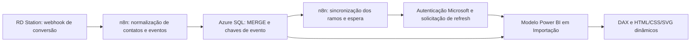

# RD Station Analytics — Power BI, HTML Dinâmico, n8n e Azure SQL

Painel de leads e conversões que combina **cards HTML/CSS gerados por DAX**, histórico de eventos, classificação de tráfego e uma engenharia de dados orientada a conversões do RD Station.

## O desafio

Segundo o autor, preparar o relatório exigia quase um dia de trabalho manual: reunir registros, cruzar informações e excluir testes. A solução passou a centralizar contatos e conversões para permitir consulta em poucos segundos, com comportamento interativo e dados atualizados por uma automação.

O ganho de tempo é um relato operacional, sem medição independente nesta publicação. O autor informa cerca de 60 segundos para atualização/consulta, dependendo dos filtros; não é um SLA nem uma garantia de execução em todo ambiente.

## O diferencial: cards que respondem ao contexto

Os cards não são imagens estáticas. As medidas calculam o valor do indicador, detectam o contexto de período, escolhem o comparativo, ajustam cores e setas e geram HTML/CSS com pequenas curvas em SVG. Títulos, textos de apoio e status também são produzidos dinamicamente.

- Contatos únicos e total de conversões.
- Contatos que solicitaram atendimento comercial — levantada de mão.
- Downloads de materiais, eventos e classificação de clientes.
- Canais de conversão, origem atribuída ao contato e últimas conversões.
- Seleção de métrica e granularidade temporal.

O relatório combina HTML Content com gráficos, tabela e segmentadores nativos. Não é integralmente HTML.

## Integração verificada

O workflow recebido contém chamada de atualização pela API do Power BI. O modelo usa **Importação**, portanto atualizar o Azure é uma etapa diferente de atualizar o dataset. A solicitação de refresh não comprova conclusão nem elimina limites de capacidade/licenciamento.

## Screenshots

Envie uma captura preparada para publicação a `assets/screenshots/` e informe o nome para conectar ao README. Não foram publicadas capturas com dados de contatos.

## Explore

- [Contexto, entregas e impacto](docs/contexto.md)
- [Cards HTML e comparativos](docs/html-dinamico.md)
- [Modelo e relacionamentos coluna a coluna](docs/modelo-relacionamentos.md)
- [Indicadores e interpretação](docs/indicadores.md)
- [Fluxo de dados e atualização](docs/integracao-atualizacao.md)
- [Normalização de tráfego e origem](docs/tratamento-atribuicao.md)
- [Inventário técnico](docs/inventario.md)
- [Como adaptar](docs/configuracao.md)
- [Validação e limites](docs/validacao.md)
- [Medidas HTML completas](dax/html)
- [Power Query](power-query)

## Escopo público

Publicação seletiva para portfólio: medidas HTML, medidas de suporte, consultas com marcadores e documentação. Não inclui PBIX/PBIP completo, dados de contatos, payloads reais, credenciais, IDs de tenant/workspace/dataset ou conexões operacionais. O JSON da automação será tratado em um case separado; aqui ele foi usado somente para verificar a arquitetura.
