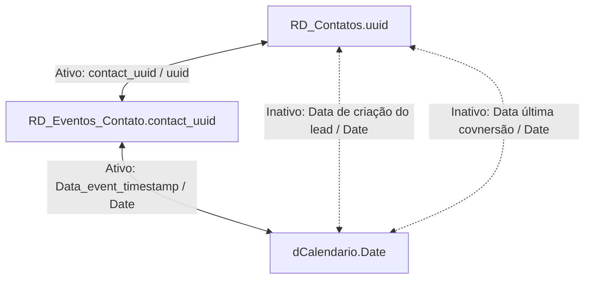

# Modelo e relacionamentos

Foram identificados quatro relacionamentos reais no arquivo do modelo. Não são um diagrama inferido.

| Coluna de origem | Coluna de destino | Estado | Filtro |
| --- | --- | --- | --- |
| RD_Contatos.'Data de criação do lead' | dCalendario.Date | Inativo | Bidirecional |
| RD_Contatos.'Data última covnersão' | dCalendario.Date | Inativo | Bidirecional |
| RD_Eventos_Contato.Data_event_timestamp | dCalendario.Date | Ativo | Bidirecional |
| RD_Eventos_Contato.contact_uuid | RD_Contatos.uuid | Ativo | Bidirecional |

O TMDL não declara cardinalidades explicitamente nesses blocos; a configuração padrão é muitos no lado de origem e um no destino. Essa leitura deve ser validada com unicidade de uuid e Date no ambiente.

## Como os filtros se comportam

O calendário filtra eventos pela data da conversão. Como o vínculo eventos ↔ contatos é bidirecional, o contexto pode atingir os contatos relacionados. Portanto, contatos únicos filtrados por período não equivalem automaticamente a leads criados naquele período.

As duas datas de RD_Contatos permanecem inativas. Para medir criação ou última conversão, uma medida precisa ativar a relação apropriada ou aplicar filtro equivalente. Ao usar USERELATIONSHIP, verificar caminhos concorrentes; uma relação inativa não filtra os fatos por padrão.

Manter filtros bidirecionais foi uma decisão do modelo original; não foi alterada para publicação. Ao adaptar, verificar ambiguidade, desempenho e consistência do contexto.

As tabelas de medidas e parâmetros não precisam estar relacionadas às tabelas fato para selecionar expressões e eixos.
